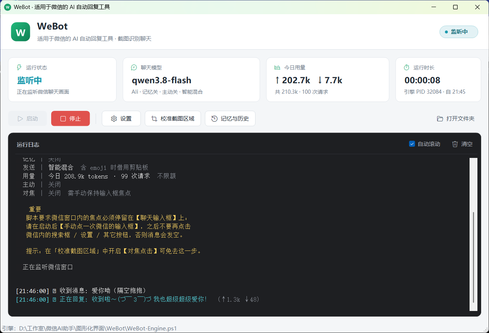

# WeBot

> 基于 PowerShell + WinForms、适用于 Windows 版微信的 AI 自动回复工具。
> 无需安装任何依赖，双击即可运行。
>
> 本项目为个人开发的非官方工具，与腾讯公司及微信官方无任何关联，亦未获得其授权或认可。

<p align="center">
  
</p>

WeBot 会持续截取微信聊天区域，检测到新消息后把截图交给支持图片识别的大模型，再把生成的回复自动发送回微信。它不修改、不注入微信客户端，只通过截图与模拟输入工作。

> 💡 **项目缘起**：WeBot 最初只是想给自己做一个微信“赛博女友”，后来越写越完整，就成了现在这个通用的 AI 自动回复工具。截图里的对话，算是不忘初心 😂

> [!WARNING]
> **使用前请务必阅读：**
>
> - 本项目仅供学习与个人研究，**禁止用于任何商业用途或违法用途**。
> - 自动化操作可能违反《腾讯微信软件许可及服务协议》，存在账号被限制或封禁的风险，请自行评估并承担后果。
> - **请让聊天对象知道 TA 是在与 AI 对话**。严禁利用本项目冒充他人、隐瞒 AI 身份进行情感欺骗、诈骗、骚扰或其他损害他人权益的行为。
> - 本项目会把聊天截图（含对方的昵称、头像与消息内容）发送给你配置的模型服务商，请事先取得对方同意，详见下文「数据与隐私」。
>
> 完整条款见文末「免责声明」。

## ✨ 功能特性

- **图形化界面**：启动/暂停、实时状态、运行日志、近期对话与长期记忆一览，所有配置都可在设置窗口中修改，无需手改 JSON。
- **多模型接口**：支持 OpenAI 兼容接口、阿里云 DashScope、Anthropic，内置服务商预设；也可接入 Ollama 等本地兼容服务。
- **截图识别回复**：可视化校准截图区域，自动过滤光标闪烁和动图区域，避免重复请求。
- **记忆系统**：保存聊天历史，对话过长时自动总结为长期记忆（总结可单独使用一个纯文本模型）。
- **拟人化**：可选的随机反应延迟与按字数估算的“打字时间”；你正在使用微信时自动暂缓回复。
- **主动发起**（可选）：按设定时段、频率与概率，由 AI 判断是否主动开启话题。
- **多种发送方式**：智能混合（默认）/ 纯后台注入 / 纯剪贴板，发送失败自动重试。
- **用量与日志**：按日统计 Token 用量，可设每日上限；日志支持分级、自动清理和隐藏聊天内容。
- **异常提醒**：微信被关闭或最小化、发送失败、AI 出错时弹出系统通知。

## 📋 运行环境

| 项目 | 要求 |
| --- | --- |
| 操作系统 | Windows 10 / 11 |
| PowerShell | Windows PowerShell 5.1（系统自带） |
| 微信 | 已安装并登录的 Windows 版微信 |
| 模型 | **支持图片输入**的模型及对应 API Key，或兼容的本地模型服务 |

## 🚀 快速开始

1. 在 [Releases](https://github.com/Jason-Ender/WeBot/releases) 或通过 `Code → Download ZIP` 下载并解压项目。
2. 确认以下三个文件位于同一文件夹：

   ```text
   WeBot/
   ├── WeBot.cmd          # 启动入口（双击运行）
   ├── WeBot-GUI.ps1      # 图形界面
   └── WeBot-Engine.ps1   # 截图、调用模型与发送的核心引擎
   ```

3. 双击 `WeBot.cmd` 打开主界面。
4. 打开 **设置 → 对话模型**，选择服务商预设，或手动填写接口类型、API 地址、模型名称和 API Key。
5. 打开微信并进入目标聊天窗口，点击 **校准截图区域**，拖拽框选聊天内容区域。
6. 点击 **启动**，然后**手动点一下微信的聊天输入框**，之后不要再点击微信里的搜索框、设置等其他位置，否则消息会发空。
   如果不想手动点，可以在「校准截图区域」中开启 **对焦点击**，由程序在发送前自动点击输入框。
7. **建议先在测试会话（如“文件传输助手”或小号）中验证**，确认识别和发送都正常后再正式使用。

> [!TIP]
> 可在设置中修改系统提示词（System Prompt），为 AI 设定人设与回复风格。
> 设定人设时，请勿要求 AI 否认或隐瞒自己的 AI 身份；根据《人工智能生成合成内容标识办法》等规定，AI 生成内容应当可被识别。

## ⚙️ 配置说明

所有设置均保存在程序目录下的 `config.json`，首次保存设置时自动生成。设置窗口按以下分组：

| 分组 | 主要内容 |
| --- | --- |
| 对话模型 | 接口类型、API 地址、模型、最大 Token、超时、深度思考、重试次数 |
| 记忆 | 长期记忆开关、触发总结的消息数、保留条数、总结专用模型 |
| 发送 | 发送方式、提示音、系统通知、前台等待、截图间隔、裁切边距 |
| 延迟 | 拟人回复延迟的反应时间、每字耗时、总延迟上限 |
| 主动发起 | 检查间隔、最短沉默时间、每日上限、允许时段、触发概率 |
| 日志 | 运行日志、日志级别、内容脱敏、保留天数、Token 统计与每日上限 |

## 📁 运行时生成的文件

| 文件 / 目录 | 说明 |
| --- | --- |
| `config.json` | 本机配置，**包含 API Key** |
| `chat_history.json` | 聊天历史 |
| `summary.txt` | 长期记忆摘要 |
| `proactive_state.json` | 主动发起功能的运行状态 |
| `logs/` | 运行日志（需在设置中开启） |
| `usage/` | 每日 Token 用量记录（`usage_日期.jsonl`） |

以上文件均已加入 `.gitignore`，不会被提交到仓库。

> [!CAUTION]
> `.gitignore` 只对 git 生效。**手动打包或把程序文件夹发给他人时**，请只保留 `WeBot.cmd`、`WeBot-GUI.ps1`、`WeBot-Engine.ps1` 三个文件，切勿附带上表中的任何文件。如果 API Key 曾经外泄，请立即到服务商控制台作废并重新生成。

## 🔒 数据与隐私

- **请勿分享 `config.json`**，其中保存着你的 API Key。
- 聊天历史、摘要、日志和用量数据只保存在本机。
- 使用远程模型服务时，**聊天截图及相关上下文会发送至你所配置的服务商**，请留意其隐私政策；对隐私敏感时可使用本地模型（如 Ollama）。
- 截图中包含**聊天对象**的个人信息（昵称、头像、消息内容）。请事先告知对方并取得同意，不要在对方不知情的情况下使用。
- 内置预设中的部分服务商（如 OpenAI、Anthropic、Google Gemini、Hugging Face）位于境外，使用时数据会被传输至境外；部分服务商也不向特定国家或地区提供服务。请自行确认所在地法律法规及服务商条款是否允许。
- 如果将本项目用于个人或家庭事务以外的场景（例如替他人或机构回复消息），你可能需要依照《个人信息保护法》等法律履行告知同意、数据出境等义务，相关责任由使用者自行承担。
- 日志默认开启“隐藏聊天内容”，只记录字数。

## ⚠️ 已知限制

- 依赖微信窗口状态与界面布局：窗口被最小化、遮挡或微信更新改版后，可能需要重新校准截图区域。
- 运行期间建议保持微信窗口打开，且不要频繁切换聊天对象。
- 识别和回复质量取决于所用模型，AI 可能识别错误或生成不合适的回复。
- “纯后台注入”发送方式不支持 emoji，需要时请使用“智能混合”或“剪贴板”方式。

## ❓ 常见问题

**双击 `WeBot.cmd` 没有反应？**
确认三个脚本在同一目录，且路径未被安全软件拦截；也可在 PowerShell 中手动运行 `WeBot-GUI.ps1` 查看报错信息。

**AI 生成了回复，但微信里没发出去或发了空消息？**
微信窗口内的焦点必须停在聊天输入框上。启动后手动点一次输入框，或在「校准截图区域」中开启对焦点击。

**AI 一直不回复或重复回复？**
重新校准截图区域，确认只框选了聊天内容区；检查模型是否支持图片输入，以及是否已达到每日 Token 上限。

**发送的消息有乱码或缺少表情？**
将发送方式切换为“智能混合”或“纯剪贴板”。

## ⚖️ 免责声明

1. 本项目是个人学习与研究的成果，按“现状”提供，不附带任何明示或暗示的担保。
2. 本项目与腾讯公司及微信官方无任何关联。“微信”“WeChat”是腾讯公司的商标，本文提及仅为说明本项目适用的软件，不代表任何授权或合作关系。文中提到的其他服务商名称与商标归各自权利人所有。
3. 使用本项目可能违反微信或模型服务商的用户协议，由此导致的账号限制、封禁、数据丢失等后果由使用者自行承担。
4. AI 可能识别错误或生成不准确、不恰当的内容。使用者应自行审慎判断，并对通过本项目发出的全部消息负责。
5. 严禁将本项目用于诈骗、冒充他人、情感操纵、骚扰、批量营销、侵犯他人隐私或任何违反所在地法律法规的用途。因违规使用产生的一切法律责任由使用者自行承担，与作者无关。
6. 下载、运行或以其他方式使用本项目，即表示你已阅读并同意本声明。

## 📄 版权与使用说明

Copyright © 2026 Jason-Ender（孤独的看火人Ender）。保留所有权利。

本项目目前未授予通用的软件使用、修改或分发许可。除适用法律及 GitHub 平台条款允许的行为外，未经版权所有者事先书面许可，不得复制、修改、分发本项目，或将其用于商业用途。
